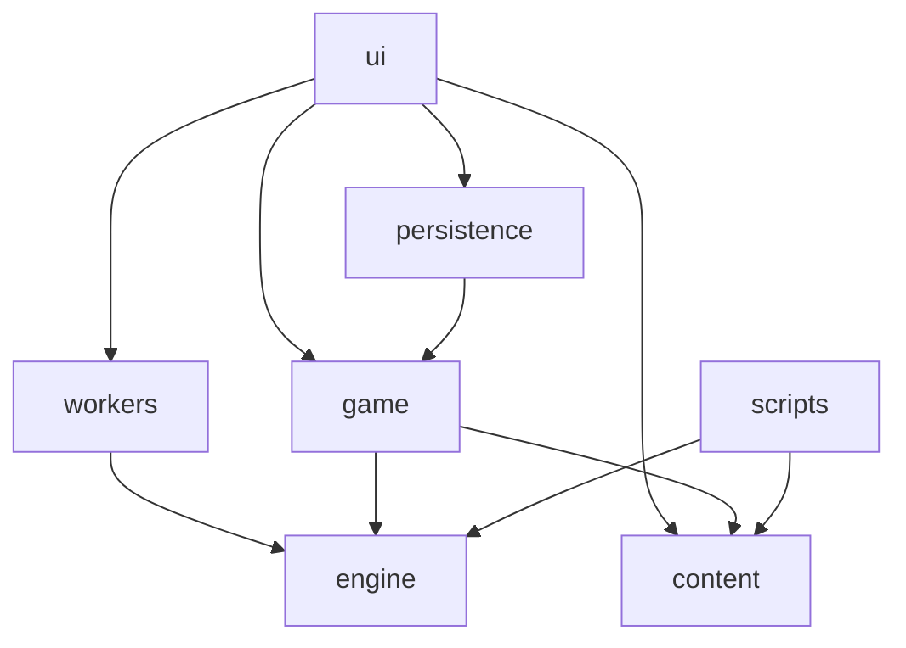
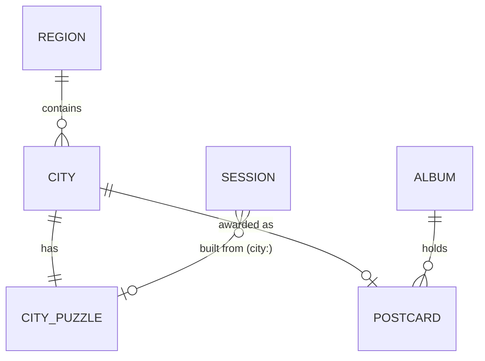
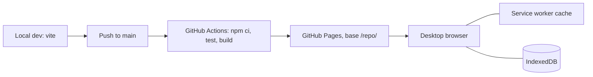

# Architecture Spine: Traveller Sudoku

## Design Paradigm

**Functional core, imperative shell.** All Sudoku and journey logic is pure TypeScript with no I/O. React, storage, the Web Worker and the service worker are a thin shell around it.

| Layer | Directory | Role |
| --- | --- | --- |
| Core: engine | `src/engine/` | Grid, candidates, Technique pipeline, solver, grader, generator, `brute.ts` (uniqueness counter), Hints |
| Core: game | `src/game/` | `AppState`, reducer and actions, journey rules (reachability, Postcard award, Tier→Difficulty map) |
| Content | `src/content/` | City catalogue, Postcard lines, Technique texts, released City Puzzles (JSON) |
| Shell: persistence | `src/persistence/` | `toDocument`/`fromDocument`, schema version, migrations, save lock, persistent-storage request |
| Shell: UI | `src/ui/` | React components and the single keyboard handler; read state, dispatch actions |
| Shell: worker | `src/workers/` | Free Play generation off the main thread |
| Build tooling | `scripts/` | Generates missing City Puzzles and verifies all of them (Node, uses the engine) |



## Invariants & Rules

### AD-1: The core is pure and imports nothing from the shell
- **Binds:** all
- **Prevents:** game rules or solving logic ending up inside components or storage code, where they can't be tested or reused by the worker and build scripts.
- **Rule:** `engine/` imports only from `engine/`. `game/` imports only from `engine/` and `content/`. Neither may use React, the DOM, `window`, storage, `Date` or `Math.random`; time and randomness come in as parameters (a seed). `scripts/` imports only from `engine/`, `content/` and `game/journey` (for the Tier→Difficulty map). Dependencies follow the diagram above and never point the other way. An architecture test in Vitest checks the import direction and the banned globals.

### AD-2: One Technique pipeline decides Difficulty and Hints
- **Binds:** FR-1, FR-8, FR-9, FR-10, FR-11, FR-23
- **Prevents:** the grader, the Hint system and the generator disagreeing about what a Puzzle needs, which would produce wrong Difficulty labels or Hints that contradict the grade.
- **Rule:** the engine has one ordered Technique registry: naked single, hidden single, naked pair, pointing, claiming. Each Technique is a module with the same signature: given the grid and the current candidates, it returns the next `Step` or nothing. The solver applies the registry in order, always taking the first Technique that finds a `Step`. Grading (the highest Technique rank used), the generator's acceptance test and Hints all call this solver. The only other solving code allowed is `engine/brute.ts`: a brute-force solution counter used by the generator and the build verification to check uniqueness. It is never used for grading or Hints.

### AD-3: A `Step` is structured data; text is rendered from content
- **Binds:** FR-8, FR-9, FR-10
- **Prevents:** explanation wording scattered through the engine and UI, and nudge and full Hints that don't match.
- **Rule:** a `Step` is `{ technique, placements[], eliminations[], focusCells[], unit }`. The engine never produces display text. The UI renders Hints from templates in `content/techniques`, keyed by `technique`. Technique definitions (FR-10) live in the same file.

### AD-4: City Puzzles are released once and never change
- **Binds:** FR-1, FR-13, FR-17, FR-18, FR-23
- **Prevents:** a City's Puzzle changing under a saved session, and a slow generator blocking offline City play.
- **Rule:** `content/city-puzzles.json` stores `{ cityId, givens, solution, difficulty }`. `scripts/build-cities` generates entries only for City ids that don't have one yet. A snapshot test fails the build if a released entry changes, or if any City Puzzle has more than one solution or a grade that doesn't match its City's Tier. Free Play Puzzles are generated in `workers/` with the same engine, from a random seed passed in.
- **One-off regeneration (TS-62, 13 Oct):** the generator now also enforces a minimum number of Givens per Difficulty (`MIN_GIVENS`: Easy 61, Medium 40, Hard 32), so all 30 City Puzzles and the snapshot were regenerated once, before release (TS-38 not done). Saved sessions keep their own `givens`/`solution` (AD-10), so an in-progress City resumes on its old grid. `build:cities` stays append-only and the snapshot test applies again from here on.

### AD-5: State changes only through the reducer; only saved slices are saved
- **Binds:** FR-2–FR-7, FR-12, FR-14, FR-16, FR-17, FR-22, FR-23
- **Prevents:** components changing state directly, a field written to storage outside the reducer and then overwritten by autosave, and save loops.
- **Rule:** `AppState = { album, sessions, settings, meta, ui }`. Only `game/reducer(state, action)` changes it; UI code dispatches actions and never mutates state. `album`, `sessions`, `settings` (Assist toggles, theme, last Free Play Difficulty) and `meta` (`seenStorageNotice`, `persistGranted`, `lastPlayedKey`) are saved. `ui` (`hint`, `undo`, `saveFailed`, `readOnly`, `updateReady`; also `savingOff`, `unreadableNotice` and the banner dismissals, as built, 2026-10-09) is never saved. Persistence saves after an action changes a saved slice; actions that change only `ui` don't trigger a save.

### AD-6: Only the reducer detects a solve; only journey logic awards Postcards
- **Binds:** FR-7, FR-12, FR-14, FR-15, FR-16
- **Prevents:** a Postcard awarded for a full-but-wrong grid, two code paths awarding Postcards, duplicates from replays, and stored unlock flags falling out of sync.
- **Rule:** after any action that changes a session's digits, the reducer checks whether `digits === solution`. If so, in the same step it marks the session `solved` and calls `journey.award(state, key)`. `award` adds a Postcard only for a key of the form `city:<id>` when that City isn't already in the Album, with `revealed: false` and `collectedOn` (a `YYYY-MM-DD` date the shell passes in with the action, since the core never reads the clock). The Postcard reveal (FR-14) shows any Postcard whose `revealed` is false, and "Add to Album" sets it to true, so a reload during the reveal shows it again. There is no `puzzleSolved` action the UI can dispatch. Reachable Cities, locked Cities and Region counts are always computed from `album` and the catalogue, never stored.

### AD-7: Saved data is one versioned document with a single writer
- **Binds:** FR-17, FR-18, FR-19, FR-24
- **Prevents:** an update breaking or wiping saved progress, two tabs overwriting each other's Postcards, and an old-version tab writing over migrated data.
- **Rule:** `persistence/` is the only code that touches storage, and the only owner of `toDocument`/`fromDocument`. It writes the whole document `{ schemaVersion, album, sessions, settings, meta }` to IndexedDB through `idb-keyval`.
  - **Modules (as built, 2026-10-09):** `persistence/document.ts` (`toDocument`/`fromDocument`, `SCHEMA_VERSION` = 2), `migrations.ts` (forward steps), `store.ts` (load, settle, the serial saver), `lock.ts` (the Web Lock) and `storage-persist.ts` (`navigator.storage.persist()`/`persisted()`).
  - **On load:** migrations run forward in order, and the lock holder writes a migrated document back once. If the stored `schemaVersion` is newer than the code's, the tab goes read-only (`ui.readOnly`) and asks the player to reload; the stored value is never written. If data can't be read, the lock holder first copies it to a new backup key that is never overwritten, then writes the default document to the main key and tells the player; the data is kept only under the backup key *(as built, 2026-10-09: the main key is overwritten after the backup, not left untouched; Epic 4 retro R3)*.
  - **Start-up give-up (as built, 2026-10-09):** lock, load and settle together are bounded by a 3 s timeout. Once start-up gives up, start-up code never starts a main-key write (no defaults after a backup, no migration write-back); a backup already started may finish (TS-42).
  - **Storage unavailable → saving off (as built, 2026-10-09):** when the load fails, start-up gives up, or unreadable data can't be backed up, the tab is not read-only: it sets `ui.savingOff`, plays normally in memory, never writes, never calls `persist()`/`persisted()`, releases the lock, and shows the saving-off banner (TS-43). Read-only is only for another tab holding the lock or newer-version data.
  - **One writer:** only the tab holding the Web Lock `traveller-save` writes. Other tabs are read-only and say the game is open elsewhere. A tab that will never write (read-only for newer data, or saving off) releases the lock *(as built, 2026-10-09)*.
  - **Persistent storage:** `navigator.storage.persist()` is requested when the player dismisses the FR-19 notice, and again after the first Postcard if it wasn't granted, only in a tab that can write. The result is stored in `meta.persistGranted`. When it isn't granted on Safari (desktop macOS Safari 17+), the notice suggests adding the game to the Dock.
  - **Failed saves** set `ui.saveFailed`.

### AD-8: Updates never interrupt a Puzzle
- **Binds:** FR-18
- **Prevents:** a new version reloading the page mid-Puzzle, and cache logic interfering with saved data.
- **Rule:** `vite-plugin-pwa` uses `generateSW` with `registerType: 'prompt'`. It pre-caches the app shell and all content. The app never calls `updateSW()` during a session. It may set `ui.updateReady`, and the new version takes over once all game tabs are closed. The service worker never reads or writes IndexedDB.

### AD-9: Hints and Mistake checks read digits, not Notes
- **Binds:** FR-5, FR-11
- **Prevents:** Hints reasoning from wrong Notes, and two different definitions of "Mistake".
- **Rule:** the engine's Hint and Mistake functions take the session's current digits and solution only, and compute candidates themselves. A Mistake is a player digit that differs from the solution. If any Mistake exists, the next Hint reports it instead of a Hint chain.

### AD-10: One `Session` shape for City and Free Play Puzzles
- **Binds:** FR-2–FR-7, FR-16, FR-17, FR-22, FR-23
- **Prevents:** Free Play keeping its grid in a different place or format, Hints unable to find a solution, and stale worker replies replacing a newer Puzzle.
- **Rule:** `sessions[key] = { key, givens, solution, digits, notes, status, difficulty, hintsUsed }`.
  - **Keys:** `city:<id>`, or `free` for the one current Free Play Puzzle.
  - **Contents:** every session carries its own `givens` and `solution`. `notes` is 81 numbers, each a 9-bit mask. `status` is `inProgress` or `solved`.
  - **Replay and restart:** replaying a solved City replaces that session with a fresh one built from content. FR-22 Restart resets `digits` and `notes` to the givens.
  - **Worker replies:** each Free Play request carries a request id. The reducer ignores a reply whose id isn't the latest. *(As built, 2026-10-09:)* the latest reply opens the Puzzle screen only if the player is still on the Free Play entry, and is set aside (only the entry returns to idle) when the old Free Play Puzzle is current, in progress and on the Puzzle screen.
  - **Settings:** `settings` holds preferences only, such as the last Free Play Difficulty.
  - **Last played:** `meta.lastPlayedKey` holds the key of the most recently changed session. The reducer updates it on any action that changes a session's digits or Notes; launch resumes that session if it is `inProgress`, otherwise the first `inProgress` City session in catalogue order, then the Free Play session; with none in progress it opens the Album.

### AD-11: A Hint runs to the next placement and lives in `ui`
- **Binds:** FR-8, FR-9, FR-11
- **Prevents:** Hints that repeat forever on Medium and Hard Puzzles (eliminations aren't stored in the grid), stale Hints after Undo, and Hint moves that can't be undone.
- **Rule:** a Hint runs the solver from the current digits until the first `Step` with a placement. It returns the chain of `Step`s, eliminations first, ending with that placement. The nudge shows the first `Step`'s Technique and `unit`; the full Hint shows the whole chain. `ui.hint` is cleared by the reducer on any change to the session's digits. "Show me the move" dispatches `hintApplied`, which goes through the same Undo path as `digitEntered` and increments `hintsUsed`. For a Mistake Hint (AD-9), `hintApplied` clears the Mistake digit instead of placing one, through the same Undo path.

### AD-12: No third-party requests, and nothing covers a Puzzle
- **Binds:** FR-14, FR-19, FR-24, PRD §5 (calm, privacy)
- **Prevents:** a font, analytics script or CDN quietly breaking privacy or offline play, and notices interrupting play.
- **Rule:** all assets are self-hosted and bundled. `index.html` sets a content security policy of `default-src 'self'` through a `<meta http-equiv>` tag, because GitHub Pages can't send custom headers. Notices (storage, save failure, read-only, update ready; as built, 2026-10-09, also saving off, unreadable data and Add to Dock) are non-modal and never cover the grid of an in-progress Puzzle. Save failure appears as an inline banner.

## Consistency Conventions

| Concern | Convention |
| --- | --- |
| Naming | Glossary terms from the PRD in code: `City`, `Region`, `Tier`, `Postcard`, `Album`, `Technique`, `Step`, `Hint`, `Mistake`, `Given`, `Session`, `FreePlay`. Files in kebab-case; types in PascalCase. |
| Code values | Tier `near` · `mid` · `far`. Difficulty `easy` · `medium` · `hard`. Region `europe` · `asia` · `americas`. The Tier→Difficulty map lives only in `game/journey`. |
| Identifiers | City id = stable kebab-case slug (for example `lisbon`), never reused. Session key = `city:<id>` or `free`. Cells are numbered 0–80 in row-major order. Digits are 1–9, and 0 means empty. |
| Grid format | Content and saved data store `givens`, `solution` and `digits` as 81-character digit strings. |
| Actions | Past-tense event names, for example `digitEntered`, `undoRequested`, `hintRequested`, `hintApplied`, `cityChosen`, `restartConfirmed` (as built, 2026-10-09: there is no `noteToggled`; Notes go through the digit actions in Notes mode). |
| Errors | The core never throws for game outcomes; it returns results. Shell errors become `ui` flags shown calmly, never browser alert boxes. |
| Input | One keyboard handler in `ui/keyboard` owns all shortcuts (FR-21). Components don't add their own key listeners. |
| Randomness | Only through an explicit seed parameter, so generation and tests are repeatable. |
| Styling | No audio. Animations respect `prefers-reduced-motion`. Colour tokens meet WCAG AA (FR-20) in light and dark themes. |

## Stack

| Name | Version |
| --- | --- |
| Starter: `create-vite` react-ts template | 9.2 |
| Vite | 8.3 |
| React / React DOM | 19.3 |
| TypeScript | 6.0 (starter pin) |
| `@vitejs/plugin-react` | 6.1 |
| oxlint (from the starter) | 1.85 |
| `vite-plugin-pwa` | 2.0 (fallback 1.3) |
| `idb-keyval` | 6.3 |
| Vitest | 5.0 |
| Node.js (development and build, pinned in `.nvmrc`) | 24 LTS; move to 26 LTS after 2026-10-28 |
| CI and hosting | GitHub Actions → GitHub Pages |

## Structural Seed

```text
traveller-sudoku/
  .github/workflows/  # ci-deploy: npm ci, lint, test, build; deploy to Pages only when PAGES_ENABLED (as built, 2026-10-09)
  scripts/            # build-cities: generate missing City Puzzles + verify all
  src/
    engine/           # grid, candidates, techniques/*, solver, grader, generator, brute, hints
    game/             # AppState, reducer.ts (entry point) + reducer-*.ts areas (grid, hint, journey, free-play, notices, shared), actions, journey (reachability, award, tier map), launch, banners (as built, 2026-10-09)
    content/          # cities.json, city-puzzles.json, techniques.ts
    persistence/      # document.ts, migrations.ts, store.ts, lock.ts, storage-persist.ts (as built, 2026-10-09)
    workers/          # free-play generator worker
    ui/               # screens: Album (also the destination chooser), Puzzle, FreePlay, Settings; keyboard; components
  tests/architecture/ # import-direction and banned-globals checks
  public/             # icons, manifest assets
```





**Deployment and environments:** local development plus one production static site on GitHub Pages. Vite's `base` is set to the repository path so the manifest and service-worker scope match. A push to `main` runs tests (including the City Puzzle snapshot and architecture tests), builds and deploys. *(As built, 2026-10-09: deploying is opt-in behind the repository variable `PAGES_ENABLED`, because the repo is private; the deploy job also refuses to publish while any City is a placeholder. The site has not gone live yet.)* There is no backend, account system or telemetry.

**Known limitation:** desktop Safari usually refuses persistent storage unless the game is added to the Dock. The Album can then be erased by Safari after 7 days without a visit. AD-7's notice tells the player this; backup is out of MVP scope.

## Capability → Architecture Map

| Capability / Area | Lives in | Governed by |
| --- | --- | --- |
| Puzzle play (FR-2–FR-7, FR-22) | `game/reducer`, `ui/` | AD-5, AD-6, AD-9, AD-10 |
| Fair Puzzles and Difficulty (FR-1, FR-13) | `engine/`, `scripts/`, `content/` | AD-2, AD-4 |
| Teaching Hints (FR-8–FR-11) | `engine/hints`, `content/techniques`, `ui/` | AD-2, AD-3, AD-9, AD-11 |
| Postcard journey (FR-12, FR-14–FR-16) | `game/journey`, `content/cities` | AD-6, AD-12 |
| Saving and offline (FR-17–FR-19, FR-24) | `persistence/`, service worker | AD-5, AD-7, AD-8, AD-12 |
| Readability (FR-20, FR-21) | `ui/` | Conventions: Styling, Input |
| Free Play (FR-23) | `workers/`, `engine/generator` | AD-2, AD-4, AD-10 |

## Deferred

- **Styling approach** (plain CSS, CSS modules or another option): no risk of parts clashing; the code decides.
- **Routing library:** a few screens switched by state is enough. Add a router only if deep links are needed.
- **End-to-end browser tests:** unit tests on `engine/` and `game/`, plus the architecture and snapshot tests, cover the risky logic. Browser tests come later.
- **Free Play generation speed:** tune only if generation is noticeably slow in practice. The worker keeps the UI responsive meanwhile.
- **Postcard pictures, touch input, accounts and backup:** out of MVP scope per the PRD. This spine leaves room for them without deciding them.
